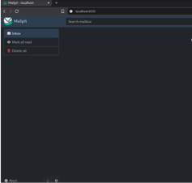
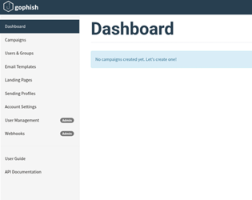
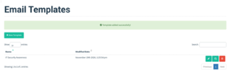
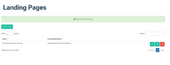
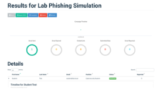

# Experiment 10: Phishing Simulation Using GoPhish

## Aim
To understand how phishing campaigns are designed and executed by creating and running a simulated phishing attack using GoPhish in a controlled lab environment.

## Requirements
- Computer or laptop
- GoPhish tool
- Web browser
- Internet connection
- Test email account
- Controlled lab environment

## Theory
GoPhish is an open-source phishing simulation tool used for security awareness training. It helps create simulated phishing campaigns to understand how attackers use fake emails and login pages to trick users. It allows security professionals to analyze user awareness and identify phishing-related risks. Phishing simulations help organizations improve email security and train users to recognize suspicious messages.

## Procedure

## Step 1:

Download and set up the GoPhish tool on the computer.

## Step 2:

Start GoPhish and open its administration interface in a web browser.

## Step 3:

Log in to the GoPhish dashboard.

## Step 4:

Create a test email template for the phishing awareness campaign.

## Step 5:

Set up a landing page for the simulation without collecting real passwords or sensitive information.

## Step 6:

Add authorized test recipients to the campaign.

## Step 7:

Configure the campaign using the created email template and landing page.

## Step 8:

Launch the simulation only for authorized test users in the controlled lab environment.

## Step 9:

Observe the campaign results and analyze user responses.

## Step 10:

Record the findings and suggest methods to improve phishing awareness.

## Result
Successfully studied the creation and execution of a simulated phishing campaign using GoPhish in a controlled environment.

## Conclusion
The experiment helped understand phishing techniques and the working of GoPhish. It also highlighted the importance of user awareness, email security and safe online practices.
