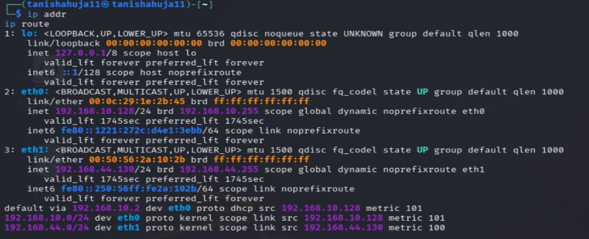
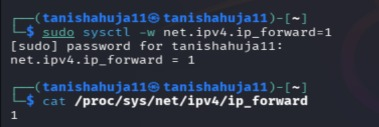
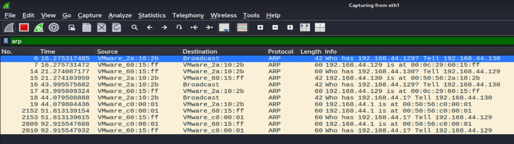
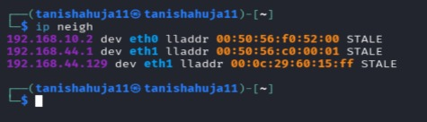
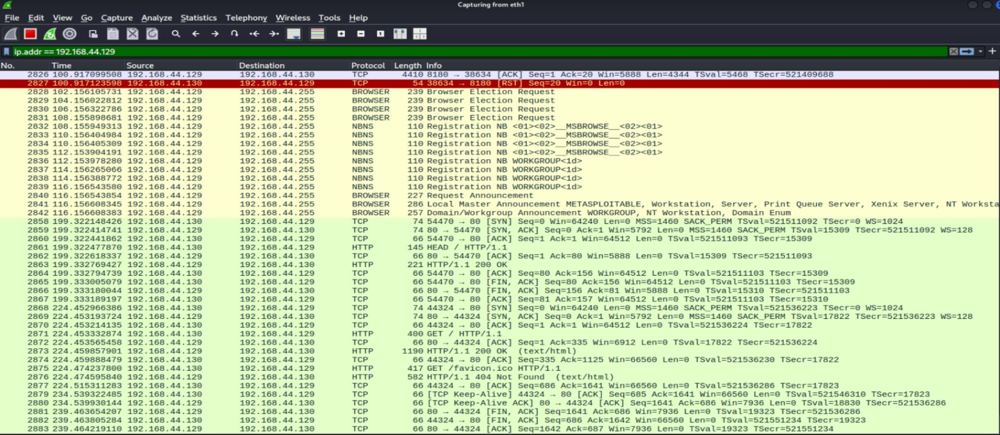
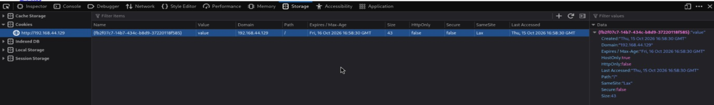

# Experiment No. 5

## ARP Spoofing and Session Hijacking

### Aim
To understand ARP spoofing and session hijacking by capturing network traffic and examining session cookies in a controlled lab environment.

### Requirements
- Kali Linux
- Metasploitable 2
- Wireshark
- VirtualBox
- ARP spoofing tool 
- Host-Only network

### Theory
ARP spoofing is a technique in which fake ARP messages are used to manipulate IP-to-MAC address mappings. Session hijacking involves gaining unauthorized access to an active user session. Wireshark helps capture and analyze network packets, while insecure session cookies may expose users to session-related attacks.

### Procedure

**Step 1: Network Setup**

Configure Kali Linux, Metasploitable 2, and the lab gateway on the appropriate virtual network. Check IP addresses using:

ip addr

Check the gateway using:

ip route

**Step 2: Enable IP Forwarding**

On Kali Linux, enable packet forwarding:

sudo sysctl -w net.ipv4.ip_forward=1

**Step 3: ARP Spoofing**

Use `arpspoof` in an isolated lab to demonstrate how false ARP messages can affect communication between lab systems. Confirm the correct interface, victim IP, and gateway IP before testing.

**Step 4: Capture Traffic in Wireshark**

Open Wireshark:

wireshark

Select the lab network interface and start capturing packets. Use the display filter:

arp

**Step 5: Filter Victim Traffic**

Use the victim's IP address to filter relevant packets:

ip.addr == <Victim-IP>

Observe the captured packets and ARP communication.

**Step 6: Visit the Test Website**

From Kali Linux, open the authorized lab website in a browser. Alternatively, use the terminal to request a page:

curl http://<Lab-Web-IP>/

**Step 7: Observe Login and Session Cookies**

Use the lab website's test login page. Inspect the browser's developer tools under **Network** or **Storage/Application → Cookies**. Observe cookie names and security attributes without copying or reusing another user's session credentials.

**Step 8: Understand Session Hijacking**

Study how an insecure or exposed session cookie could be misused. Note that HTTPS, secure cookie settings, and session expiration help reduce session-hijacking risks.

**Step 9: Stop and Restore**

Stop the capture and any test processes. Disable IP forwarding:

sudo sysctl -w net.ipv4.ip_forward=0

Save the Wireshark capture if required.

### Result
ARP traffic was captured and analyzed using Wireshark, and the risks associated with insecure session cookies and session hijacking were studied.

### Conclusion
The experiment demonstrated ARP spoofing concepts, network traffic analysis, and the security risks of exposed session information. It highlighted the importance of HTTPS and secure session management.
