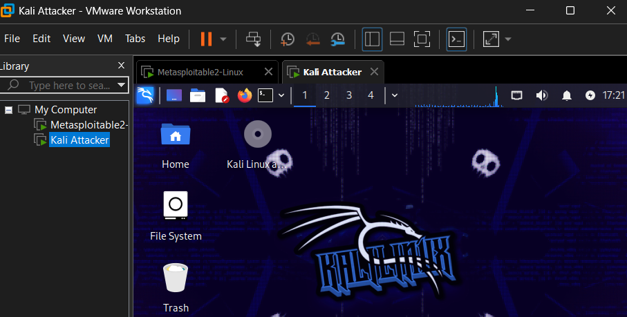
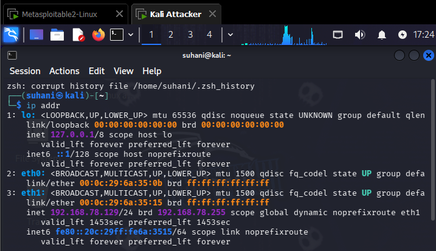
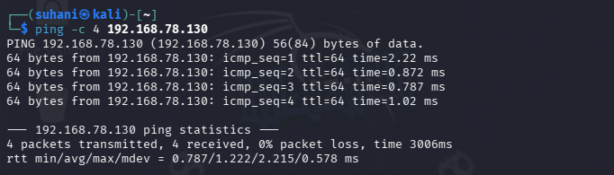
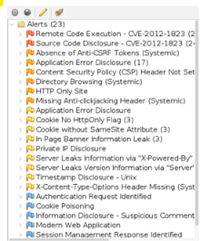
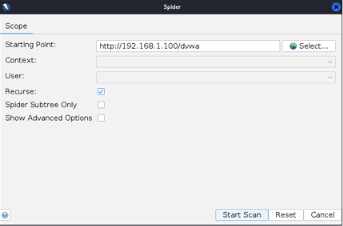
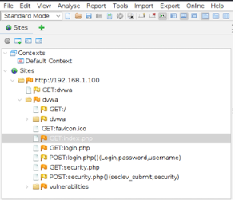
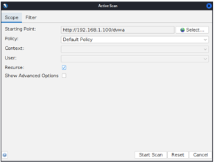
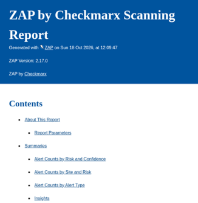

# Experiment No. 6

## Website Risk Assessment Using OWASP ZAP

### Aim
To scan a web application using OWASP ZAP and identify vulnerabilities according to the OWASP Top 10 checklist.

### Requirements
- Kali Linux
- Metasploitable 2
- OWASP ZAP
- DVWA web application
- VirtualBox

### Theory
OWASP ZAP is a web application security testing tool used to detect vulnerabilities such as SQL Injection, Cross-Site Scripting (XSS), and security misconfigurations.

### Procedure

**Step 1: Configure Network**

Configure Kali Linux with NAT and Host-Only adapters. Connect Metasploitable 2 to the Host-Only network.

**Step 2: Find IP Addresses**

Run the following command:

ip addr

**Step 3: Test Connectivity**

ping -c 4 192.168.56.101

**Step 4: Access DVWA**

Open the browser and visit:

http://192.168.56.101/dvwa/

**Step 5: Install and Launch OWASP ZAP**

sudo apt update
sudo apt install zaproxy -y
zaproxy

**Step 6: Start Automated Scan**

In ZAP, select **Quick Start → Automated Scan**. Enter the DVWA URL and click **Attack**.

**Step 7: View Vulnerabilities**

Open the **Alerts** section to view detected vulnerabilities and their risk levels.

**Step 8: Document Vulnerabilities**

Record the vulnerability name, severity, URL, evidence, and OWASP Top 10 category.

**Step 9: Generate Report**

Select **Report → Generate Report** and save the report in HTML or PDF format.

### Result
OWASP ZAP was used to scan the DVWA web application and identify potential security vulnerabilities.

### Conclusion
The experiment demonstrated how OWASP ZAP detects web application vulnerabilities and helps assess website security.

