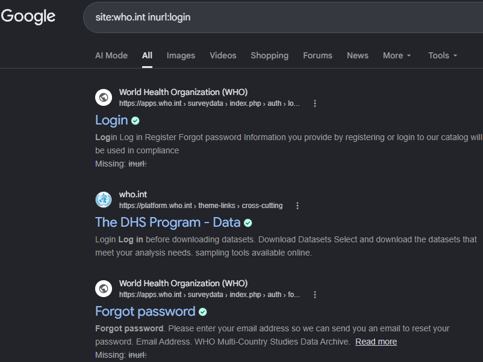
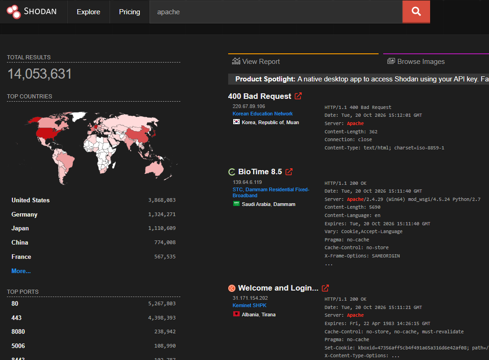
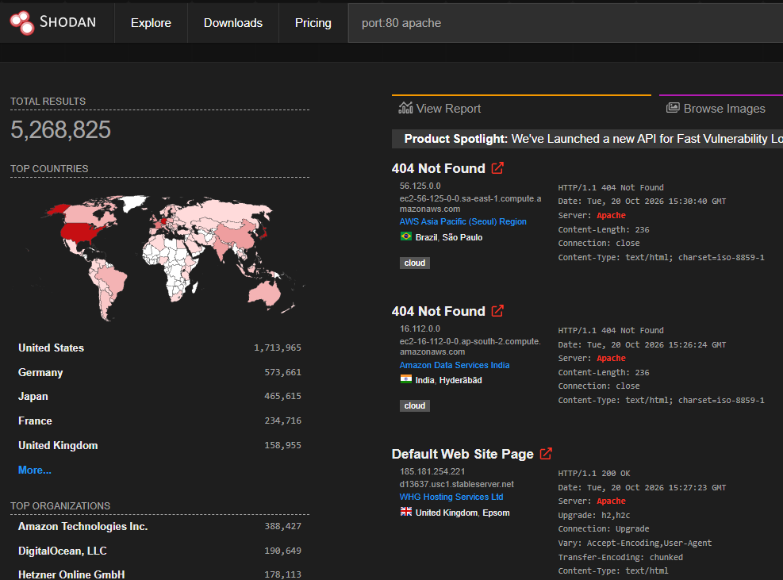
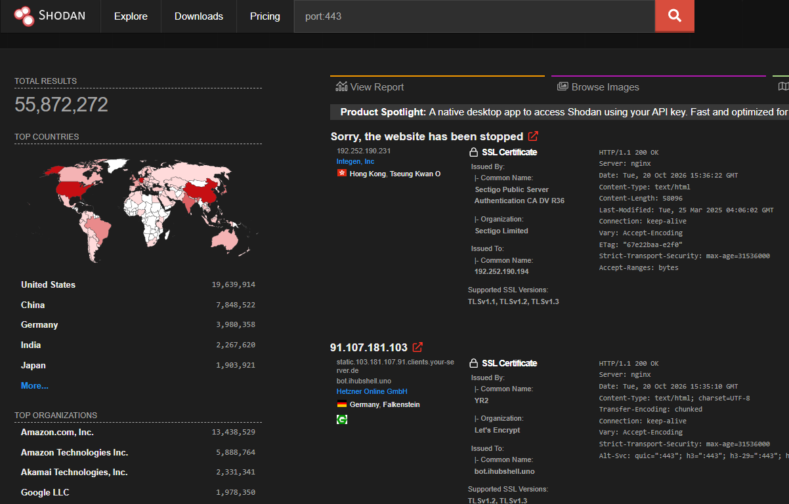
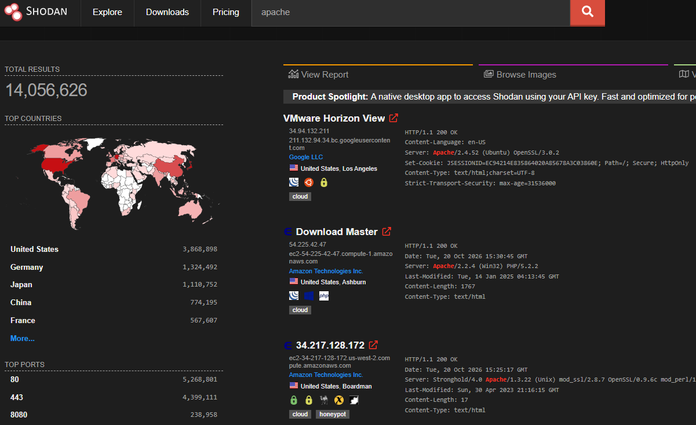

# Experiment No. 7

## Title: Using OSINT Tools for Reconnaissance

### Aim
To perform passive reconnaissance using Google Dorks and Shodan to collect publicly available information about a target.

### Requirements
Computer, internet connection, web browser, Google Search and Shodan.

### Theory
OSINT (Open Source Intelligence) is the process of collecting information from publicly available sources. Google Dorks helps locate specific indexed information using advanced search operators, whereas Shodan identifies internet-connected devices and their publicly visible services, ports and banners.

### Procedure

**Step 1: Open Google Search**

Open a web browser and visit Google Search.

**Step 2: Perform Google Dorking**

Enter search queries to find publicly indexed information about an authorized target.

Examples:
- site:example.com
- site:example.com filetype:pdf
- site:example.com inurl:login

**Step 3: Analyze Google Results**

Review the results and identify relevant public webpages, documents and directories. Record the findings.

**Step 4: Open Shodan**

Visit https://www.shodan.io/ and create a free account if required.

**Step 5: Enter Shodan Queries**

Enter suitable search queries to explore publicly visible services.

Examples:
- apache
- port:21 country:"IN"
- product:"MongoDB"

**Step 6: Analyze Shodan Results**

Observe the displayed IP addresses, open ports, service details and banners for authorized targets.

**Step 7: Record Findings**

Document the relevant information collected from Google Dorks and Shodan for security analysis.

### Expected Output
Google Dorks displays indexed information, while Shodan displays details about internet-connected devices and their publicly visible services.

### Result
Passive reconnaissance was studied using Google Dorks and Shodan to identify publicly available information.

### Conclusion
The experiment demonstrated how OSINT tools support the initial phase of security assessment by helping identify publicly exposed information and potential security risks.

All activities should be limited to authorized targets and publicly available information.
